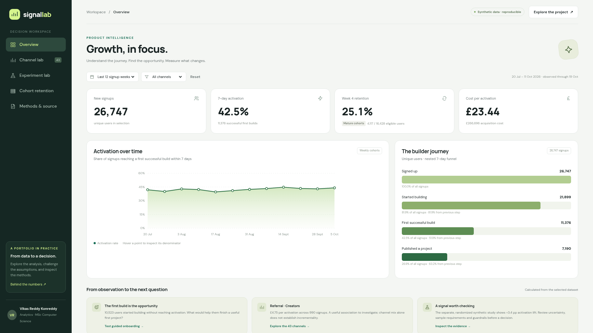

# SignalLab — Growth decision studio

**Acquisition, experiments and retention in one inspectable analytics prototype.**

[Open the live demo](https://signallab-vikas-reddy.lovable.app/) · [Numerical checks](analysis/verify.py) · [SQL queries](analysis/metrics.sql)



An interactive, AI-assisted portfolio prototype prepared for **Vikas Reddy Konreddy**, connecting commercial analytics experience at Axtria with MSc Advanced Computer Science studies at the University of Hertfordshire.

All 26,747 user records are synthetic. This is not Axtria, client or Lovable production data, and simulated effects are not real business achievements.

## Open the app

Open `SignalLab.html` in a modern browser. No server, installation, login or API key is needed. The application and data are embedded in the HTML file. Optional Google Fonts fall back to system fonts when unavailable.

The editable source is in `dist/`. `dist/index.html` is the identical portable build.

## What is implemented

- **Overview:** acquisition filters, unique-user funnel, weekly activation and denominator-aware metrics.
- **Channel lab:** 43 searchable, sortable channels and a constrained allocation sandbox for 16 paid channels. Total spend stays fixed; a sensitivity setting changes the assumed response curve.
- **Experiment lab:** a randomized synthetic onboarding test, Wilson and Newcombe intervals, two-sided z-test, fixed sample plan, sample-ratio check, two intention-to-treat guardrails, and an editable count calculator.
- **Cohort retention:** a maturity-aware heatmap and weighted retention curve. Missing follow-up is displayed as a blank rather than zero.
- **Methods & source:** metric definitions, limitations, six data-quality checks, and source/data export controls.

The planning calculator does not alter the experiment's original sample requirement. Custom inputs do not produce a rollout recommendation without a study design or guardrails. Sparse data receive an explicit warning about the z-test approximation.

## Reproduce the data and app

From the project root, using Python 3:

```bash
python3 analysis/generate_data.py
python3 build.py
```

Generation and building use only the Python standard library. `analysis/users.csv`, `analysis/channel_costs.csv` and `dist/data.json` are regenerated using seed **43121**.

The raw user CSV stores point-retention flags in `active_week_mask`: bit 0 is signup activity, bit 1 is week-1 activity, bit 4 is week-4 activity. For example, `(active_week_mask & 16) != 0` identifies a week-4 return. Signup weeks 0–7 are fully eligible for week 4 at this snapshot.

## Verification

```bash
python3 analysis/verify.py
```

The verification script requires Node.js and SciPy. It checks the browser's statistical calculations against SciPy, executes the supplied SQL against the raw data in SQLite, checks zero-denominator cases and verifies the fixed budget and per-channel bounds across 15 allocation scenarios.

Browser checks covered all five views, period and group filters, no-mature-cohort handling, search, budget zero-change behavior, sample planning, invalid experiment counts and a valid custom comparison. Export controls report download initiation; the automated browser could not provide a completed download file, so completion of browser downloads was not independently verified. The same raw files and source are included in this package.

## Results to discuss — synthetic only

| Metric | Value |
|---|---:|
| Users | 26,747 |
| 7-day activations | 11,376 |
| Activation rate | 42.53% |
| Week-4 eligible users | 16,428 |
| Week-4 returning users | 4,117 |
| Control | 1,498 / 3,731 |
| Variant | 1,642 / 3,774 |
| Absolute activation lift | 3.358 percentage points |
| Relative activation lift | 8.364% |
| Two-sided primary p-value | 0.0031913 |
| Approximate 95% difference interval | +1.13 to +5.59 percentage points |
| Pre-specified sample requirement | 2,389 users per arm |

## Published Lovable project

Live app: https://signallab-vikas-reddy.lovable.app/

Lovable editor: https://lovable.dev/projects/9f2095dc-5d71-44c8-b673-f05ef5a95047

The project is published publicly and does not require a password. The tested self-contained app is served unchanged inside the Lovable project's full-viewport React route. The public homepage and experiment navigation were verified after publication. Keep the synthetic-data and AI-assistance disclosures when describing the project.

`LOVABLE_BUILD_BRIEF.md` records the build brief. No password, API key or private client data is included.
